# Tsumugi Mobile: Reference for Aligning the Website

> **Purpose:** a reference and data sheet taken from the mobile app so the website's workspace can be brought closer to it **to a chosen degree**, while keeping what is right for the web (wider layouts, hover, keyboard, the playful landing page).
> **Written:** 2026-11-15. **Source of truth:** the Flutter code in this repository (`lib/core/theme/`, `lib/shared/widgets/`), not this file. If they disagree, the code wins and this file is stale.
> **Website files compared:** `CTINASSL_Activity/client/src/styles/base.css`, `workspace.css`, `workspace-pages.css`, `motion.css` (read on 2026-11-15).
> **Honest limits:** the mobile app has been used by one person on one phone and has not been through usability sessions (see [PLAN-UX.md](PLAN-UX.md)). "Better" below means "followed a documented rule and looked better to the owner", not "proven better for users". Numbers marked *measured* were measured; numbers marked *computed* were calculated from the colours; everything else is a design decision.

## 1. How to use this document

1. Read section 2 to decide **how far** to align (a menu of degrees).
2. Copy the **token block** in section 4 into the website's CSS (it keeps every existing name and adds new ones).
3. Use sections 5 to 9 as the spec for each piece (typography, components, layout, motion).
4. Use section 11 as the ordered to-do list for the website.
5. Section 12 lists what the website has that mobile does not, and what to leave different on purpose.

## 2. How far to align: a menu of degrees

| Degree | What it covers | Risk to the website's identity | Effort |
|---|---|---|---|
| **A. Tokens only** | Add the new colour roles, a dark palette, a 3:1 control border, the type scale and motion tokens as CSS variables; change nothing visible yet | None | S |
| **B. Quality fixes** | Apply A where the mobile work found real problems: input and control borders at 3:1, the Undo-style toast timing, reduced-motion behaviour, text size floors, status colours from tokens | Low (borders get darker) | S to M |
| **C. Hierarchy and density** | The mobile "one focal point" rules on Home, Tasks, Projects, Library: a headline, two-line rows, colour only for exceptions, fewer boxes | Medium (the workspace looks calmer) | M |
| **D. Interaction patterns** | In-place task actions (complete circle, menu, undo), grouped lists with counts, quick-add chips, settings that apply at once | Medium (behaviour changes) | M to L |
| **E. Motion** | The motion spec (section 9) on the workspace, not the landing page | Low | M |
| **F. Full parity** | Everything above plus dark mode switch and copy changes | Highest | L |

The website's **landing and auth pages** (parallax, cursor ring, GSAP reveals, drifting orbs) are not part of this: they are brand, not workspace, and mobile deliberately skips them. A to B is safe to do first and separately; C and D change how the workspace feels and should be tried on one screen first (Tasks or Home).

## 3. What is already the same

The base palette is **identical** to the website's. These are in both: `--paper #fffdfd`, `--canvas #f8f6fb`, `--ink #2f2938`, `--muted #655f70`, `--pink #c73579`, `--pink-soft #ffe8f5`, `--blue-soft #e5f4ff`, `--lilac #ead9f8`, `--green #5c8a6b`, `--green-soft #e8efe9`, `--butter #f8d95a`, `--line #e9e3ed`, `--line-strong #d8d0e0`. Also the same: the font (Fredoka), the spacing scale (4, 8, 12, 16, 24, 32), the radii (8, 14, 20), the six status tones with the same soft and text colours, the page gutter (16), the 12 px minimum text size, and the vocabulary (task, project, milestone, requirement, file, change, library). The mobile code was extracted from the website's CSS in the first place.

## 4. Token reference and paste-ready CSS

### 4.1 Colours (hex, role, contrast)

Contrast ratios are *computed* (WCAG formula). A pair that is text on a background should be at least 4.5:1 (normal text); UI boundaries and icons at least 3:1.

| Token (CSS name suggested) | Mobile role | Light | Dark | Used for | Light ratio | Dark ratio |
|---|---|---|---|---|---|---|
| `--paper` | surface | `#fffdfd` | `#1f1b26` | cards, sheets, inputs | ink on it 13.9 | ink on it 14.8 |
| `--canvas` | background | `#f8f6fb` | `#17141c` | page | ink on it 13.1 | ink on it 16.0 |
| `--ink` | on surface | `#2f2938` | `#f3eef8` | main text, selected outline | n/a | n/a |
| `--muted` | on surface muted | `#655f70` | `#b9b2c4` | secondary text | 6.1 on paper | 8.2 on paper |
| `--pink` | accent | `#c73579` | `#f08cbb` | primary buttons, links, badges | 4.9 on paper | 7.4 on paper |
| `--on-accent` (new) | on accent | `#ffffff` | `#17141c` | text on pink or solid green | 5.0 on pink | 8.0 on pink |
| `--pink-soft` | accent container, danger container | `#ffe8f5` | `#3b2233` | selected fills, danger pill | | |
| `--blue-soft` | info container | `#e5f4ff` | `#1e2e3a` | info pill, tip banner | | |
| `--lilac` | | `#ead9f8` | `#2f2540` | decoration, offset shadows | | |
| `--green` | | `#5c8a6b` | `#8fc2a0` | progress fill, done | 3.9 on paper | 8.4 on paper |
| `--green-soft` | success container | `#e8efe9` | `#22302a` | success pill | | |
| `--butter` | | `#f8d95a` | `#f8d95a` | highlights | | |
| `--butter-soft` | warning container | `#fff2cf` | `#3a3320` | warning pill | | |
| `--line` | outline (quiet) | `#e9e3ed` | `#332d3c` | dividers, card edges | 1.2 on paper | |
| `--line-strong` | outline strong | `#d8d0e0` | `#453e50` | decorative edges only | 1.5 | 1.7 |
| `--control-border` (**new**) | control outline | `#857d90` | `#827a92` | input, outlined button, unselected chip, empty status circle | **3.9** | **4.1** |
| `--neutral-soft` / `--neutral-text` | neutral tone | `#f1eef5` / `#4a4455` | `#2c2733` / `#d9d2e3` | | 8.1 | 9.9 |
| `--info-text` | info tone text | `#1d5f80` | `#8fcbea` | | 6.2 on blue-soft | 7.9 |
| `--progress-soft` / `--progress-text` | progress tone | `#ece6fb` / `#5a45a8` | `#2f2540` / `#c9b9f5` | | 6.1 | 8.0 |
| `--warning-text` | warning tone text | `#7a5600` | `#f2ce6b` | | 6.0 on butter-soft | 8.3 |
| `--danger-text` | danger tone text and overdue | `#a3205c` | `#ff9dc4` | | 6.2 on pink-soft, 7.1 on paper | 7.4, 8.8 |
| `--success-text` | success tone text | `#2f6a42` | `#a9d8b8` | | 5.5 on green-soft | 8.7 |

**Why `--control-border` exists:** the website's inputs and chips use `--line-strong` (`#d8d0e0`), about **1.5:1** against the page. WCAG 2.2 1.4.11 asks for 3:1 for the edge of a control that needs it to be identified. The mobile app switched all controls to `--control-border`; dividers and card edges keep the quiet lines. Mobile has not been audited by a third party; this is a check against the criterion, not a certification.

### 4.2 Paste-ready CSS (keeps existing names, adds new ones)

```css
:root {
  /* existing (unchanged) */
  --paper: #fffdfd;  --canvas: #f8f6fb;  --ink: #2f2938;  --muted: #655f70;
  --pink: #c73579;   --pink-soft: #ffe8f5; --blue-soft: #e5f4ff; --lilac: #ead9f8;
  --green: #5c8a6b;  --green-soft: #e8efe9; --butter: #f8d95a;  --line: #e9e3ed;

  /* new, from mobile */
  --butter-soft: #fff2cf;
  --line-strong: #d8d0e0;          /* decorative edges only */
  --control-border: #857d90;       /* controls: >= 3:1 */
  --on-accent: #ffffff;

  /* status tones: one place, used by badges and due text */
  --tone-neutral-bg: #f1eef5;  --tone-neutral-fg: #4a4455;
  --tone-info-bg: #e5f4ff;     --tone-info-fg: #1d5f80;
  --tone-progress-bg: #ece6fb; --tone-progress-fg: #5a45a8;
  --tone-warning-bg: #fff2cf;  --tone-warning-fg: #7a5600;
  --tone-danger-bg: #ffe8f5;   --tone-danger-fg: #a3205c;
  --tone-success-bg: #e8efe9;  --tone-success-fg: #2f6a42;

  /* roles (use these in new CSS instead of palette names) */
  --background: var(--canvas);  --surface: var(--paper);  --on-surface: var(--ink);
  --on-surface-muted: var(--muted);  --accent: var(--pink);  --accent-container: var(--pink-soft);
  --danger: var(--tone-danger-fg);   --warning: var(--tone-warning-fg);
  --success: var(--tone-success-fg); --info: var(--tone-info-fg);

  /* spacing, radii, sizes (same as the workspace, plus two) */
  --space-1: 4px; --space-2: 8px; --space-3: 12px; --space-4: 16px; --space-5: 24px; --space-6: 32px;
  --space-page: 16px;
  --radius-sm: 8px; --radius-md: 14px; --radius-lg: 20px;
  --target-min: 48px;              /* mobile and touch; use >= 44px on web touch, 40px with a mouse */

  /* motion (section 9) */
  --motion-press: 80ms;  --motion-fast: 120ms;  --motion-short: 200ms;
  --motion-tab: 240ms;   --motion-page: 300ms;  --motion-number: 400ms;
  --motion-reduced: 100ms;
  --ease-enter: cubic-bezier(0.05, 0.7, 0.1, 1);
  --ease-standard: cubic-bezier(0.33, 1, 0.68, 1);   /* ease-out-cubic */
  --ease-exit: cubic-bezier(0.32, 0, 0.67, 0);       /* ease-in-cubic */
}

/* Dark palette. Follow the device by default; a [data-theme] attribute can force either. */
@media (prefers-color-scheme: dark) {
  :root:not([data-theme='light']) {
    --paper: #1f1b26;  --canvas: #17141c;  --ink: #f3eef8;  --muted: #b9b2c4;
    --pink: #f08cbb;   --pink-soft: #3b2233; --blue-soft: #1e2e3a; --lilac: #2f2540;
    --green: #8fc2a0;  --green-soft: #22302a; --butter: #f8d95a;  --butter-soft: #3a3320;
    --line: #332d3c;   --line-strong: #453e50; --control-border: #827a92; --on-accent: #17141c;
    --tone-neutral-bg: #2c2733;  --tone-neutral-fg: #d9d2e3;
    --tone-info-bg: #1e2e3a;     --tone-info-fg: #8fcbea;
    --tone-progress-bg: #2f2540; --tone-progress-fg: #c9b9f5;
    --tone-warning-bg: #3a3320;  --tone-warning-fg: #f2ce6b;
    --tone-danger-bg: #3b2233;   --tone-danger-fg: #ff9dc4;
    --tone-success-bg: #22302a;  --tone-success-fg: #a9d8b8;
  }
}
:root[data-theme='dark'] { /* same values as the block above */ }
```

Differences to know about: the website's `.progress__track span` fills with `--ink`; mobile fills with `--green` (and animates). The website's `.due--today` is amber and `.due--soon` blue; mobile makes only **overdue** coloured (see 7). The website's primary borders are `2px solid var(--ink)` with an offset `box-shadow: 4px 5px 0 var(--lilac)` on menus; mobile is flat with no shadows (ink outline only on selected and primary buttons).

## 5. Typography

Font: **Fredoka** (400, 500, 600, 700 are bundled in the app; the website loads 400 and 700). The mobile scale gives titles and row text different weights (600 and 500) so lists read calmly.

| Style | Mobile | Where used | Website today | Suggestion |
|---|---|---|---|---|
| Display | 32 / 700, line 1.15, letter -0.6 | page title, Home headline | h1 28 | 28 to 32 on workspace pages |
| Headline small | 26 / 700, line 1.2, letter -0.4 | project progress statement | 26 (some pages) | keep |
| Title | 20 / 600, line 1.25, letter -0.3 | sheet and card titles | h2 20 | add weight 600 (not 700) |
| Section / title medium | 16 / 600 | section labels, group headers | h3 16 | same |
| **Row title** | **16 / 500** | list rows | mixed 700 | use 500 so rows do not shout |
| Body | 15, line 1.45 | paragraphs | 14 | 15 on phones, 14 on dense desktop tables |
| Body large | 16, line 1.5 | reader | | |
| Meta / body small | 13, line 1.4 | second line in rows, helper text | 13 and 12 mixed | one value: 13 |
| Label | 12 / 600 | badges, chips, tab counts | 12 | keep (this is the minimum) |

Rules that carry over: **never below 12 px**; the document reader lets the person step text 0.9 to 1.5 times; all layouts were tested at 200% text (phones) and 130% at 320 px wide. For the web, size in `rem` so browser zoom and text-only zoom work.

## 6. Spacing, radii, targets

| Token | Value | Notes |
|---|---|---|
| Spacing scale | 4, 8, 12, 16, 24, 32 | same as web |
| Page gutter | 16 | same as web |
| Between blocks | 24 to 32 (`--space-5`, `--space-6`) | bigger than inside a block (4 to 12): this gap is what makes groups readable |
| Radii | 8 small, 14 medium, 20 large, 999 pills and circles | same as web |
| Touch target | 48 x 48 minimum | web nav uses 44 and 48, search 40; WCAG 2.5.8 AA needs 24, 2.5.5 AAA needs 44 |
| Hairline | 1 | dividers inset 56 px under a task row so they start at the text, not the circle |

## 7. Component specs (mobile) and web equivalents

Each entry: what it is, the measurements, then a CSS sketch. All colours are tokens from 4.2.

### 7.1 Task row ("tile")

Two lines, no card border, no per-row background; a hairline under it.

```
(O)  Title of the task, up to two lines                     Today
     Project Garden · ↑ High · 2/4 · ⊗ Blocked
```

- Left: a **status circle** 24 px with a 2 px ring in `--control-border`, inside a 48 x 52 hit area. Doing = half-filled in ink; Done = filled green with a white check. Tap completes or reopens.
- Title: 16 / 500, `--ink` (done: `--muted`, struck through). Right: due text, 13, only **overdue** is coloured (`--danger`, with a warning icon); **today** is bold ink; later dates are muted.
- Second line (13, `--muted`): project, `↑ High` (icon plus word, muted, not coloured), subtask count `2/4`, **Blocked** (danger colour, icon plus word; the only other alert), a "Session only" tag when added in the session.
- Removed from the row on purpose (they are in the detail panel): milestone name, progress ring, high-priority yellow, blue "soon" date.
- Padding 12 top and bottom, 16 right. Selected: `--accent-container` fill. Divider `1px var(--line)` inset 56 px.
- Actions (all mirrored in a menu): tap circle = complete; swipe right = complete; swipe left = tomorrow; press and hold = menu (status, tomorrow, pick a date, remove date, high priority, blocked, edit, details, delete). On the web: circle click, row menu on right-click or a kebab, drag is not needed.

```css
.task { display: grid; grid-template-columns: 48px 1fr auto; align-items: start; padding: 12px 16px 12px 0; border-bottom: 1px solid var(--line); }
.task__title { font-size: 16px; font-weight: 500; line-height: 1.3; }
.task__meta { font-size: 13px; color: var(--muted); display: flex; flex-wrap: wrap; gap: 4px 8px; }
.task__due { font-size: 13px; color: var(--muted); text-align: right; }
.task__due--overdue { color: var(--danger); font-weight: 600; }
.task__due--today { color: var(--on-surface); font-weight: 600; }
.task--done .task__title { color: var(--muted); text-decoration: line-through; }
.status-circle { width: 24px; height: 24px; border: 2px solid var(--control-border); border-radius: 50%; }
```

### 7.2 Section label and group header

A section label (`Up now`, `Continue`, `Up next`) is **16 / 600** with a quiet text action at the right (`All tasks (6)`); a group header in a list (`Overdue 2`) is the same style plus a muted count and **stays pinned** under the tabs while its rows scroll. No boxes or rules around them.

### 7.3 Headline block (Home)

A date line (13 / 600 muted), a **display headline that states how things stand** ("2 tasks need you", red when anything is overdue; "N tasks are due today"; "You are all caught up"), then one line of figures ("2 overdue · 1 due today · 6 in progress"). The whole block is a link to the full list. It replaced four figure boxes, a title and a subtitle. Rule: **one headline per screen**, the largest thing on the page.

### 7.4 Cards

White (`--surface`) with a 1 px `--line` edge, radius 20 for project and file cards, 14 for small rows; no tint fills (the older pink and blue tinted project cards were removed because they dominated); 16 inner padding. Project card: name (20 / 600), category (13 muted), status pill (+ "At risk" pill only when at risk), progress bar, "Next: milestone, date". Description is not on the card.

### 7.5 Pills, badges, chips

- **Status pill:** radius 999, padding 3 x 9, 12 / 700, tone colours from 4.2; always **icon plus text**, never colour alone.
- **Chip (selectable):** height 48 including padding (touch), 12 to 13 / 700, 14 horizontal padding, border `--control-border`; selected: fill `--accent-container`, border `--ink`. Colour changes over 120 ms.
- **Glance chip** (older Home figures) was removed.

### 7.6 Buttons

Primary: pink fill, `--on-accent` text, **2 px ink outline**, pill shape, min 48 high. Secondary: transparent, same outline. **Quiet (new):** text-only in `--accent`, no outline, for actions that must not compete with content ("New project", "Add file", "Edit project"). There is at most **one** primary button visible per screen; on list screens the primary action lives in the bottom bar's round **+**.

### 7.7 Inputs

Filled `--surface`, 14 px radius (search is a pill), border `--control-border` 1 px (2 px ink when focused), label or hint text always present. Search and filter share one row (search flexes, filter is a round 48 px button with a count when active). On the Today list the search row is **hidden** so the add box is the only box; other views keep search and filter.

### 7.8 Progress

A bar 8 px high, track `--line`, fill `--green`, radius 999, filled left to right; the count in 13 muted at the right (`1/7`). On the project page it is preceded by a statement ("1 of 7 tasks done", 26 / 700) and followed by one muted line of other figures. Animates from empty on first view and from the old to the new value on change (section 9).

### 7.9 Tabs and view switches

Underlined text tabs with counts (12 muted), 48 high, selected = ink 3 px underline; a row that scrolls sideways **fades at the cut-off edge** so a hidden tab is hinted. A two- or three-way **segmented toggle** (pill track in `--line`, selected = ink outline) is used for layout (List / Grid) and view (Projects / Timeline); it is small and left-aligned, not full width.

### 7.10 Toast with Undo

A dark pill (light on dark theme) at the bottom above the navigation: message, then **Undo** (opposite tone). Appears over sheets too. **Stays 10 seconds**, or until acted on or dismissed when a screen reader is on (a Dismiss button appears). Fades out. This is the rule for every in-place change: **act first, offer Undo (20 steps), never a confirmation dialog**; the only confirmations are for throwing away typed text.

### 7.11 One-time tip

A tinted banner (`--blue-soft`) with an icon, one sentence and "Got it"; shown once per session above the first group; collapses smoothly; can be brought back in settings ("Show tips again"). Not a tour: one tip, at the point of need.

### 7.12 Bottom navigation (phone) and rail (wide)

Four destinations plus a round **+** in the middle (48 to 52 px, pink, 2 px ink ring): Home, Projects, Tasks, Library. Label always visible (12 / 700, capped at 130% text size). A **badge** on Tasks shows the overdue count in danger colour. The selected item sits in a pill (`--accent-container`, ink outline). The top bar is the **same on every main tab**: logo, search icon, account icon; the page's own title (32 / 700) sits under it. Wide screens (840 px and up) use a side rail with the same items plus search and account, and a docked detail panel.

### 7.13 Sheets and detail panels

Bottom sheets with a drag handle, radius 20 at the top, scrollable; task details show status, flags, notes, due, milestone, subtasks (tappable), a "Why it exists / What it becomes" block with relation chips, and real actions (Mark done, Edit task, Change status, Mark blocked). Preview-only actions explain themselves: a title ("Preview only") and a **specific sentence** about what the real product would do and what works in the demo.

## 8. Layout and hierarchy rules (the principles behind the screens)

These are the rules the mobile screens were reworked to follow after the owner's feedback that the first screens showed too much at once with nothing guiding the eye. They are the part most worth carrying to the website.

1. **One focal point per screen**, set by size and weight, not by colour or boxes: Home = the headline; Tasks = the add box and the first group; Projects = the first project; project page = the progress statement.
2. **Order of weight:** headline (32) → section label (16 / 600) → content (16 / 500 or 15) → meta (13 muted). No other sizes in between.
3. **Colour is for exceptions:** overdue and blocked are the only status colours in lists. Priority, subtasks, milestone, "soon" and "today" are text weight or muted, not hues.
4. **Two lines per row.** The title and when it is due; one quiet meta line. Anything else is in the detail view.
5. **Fewer boxes.** Rows are not cards; groups are separated by space (24 to 32), not borders; only controls and genuine cards have edges.
6. **Spacing outside groups > inside groups** (24 to 32 against 4 to 12).
7. **Quiet secondary actions** (text buttons) so the page has at most one loud button.
8. **Reference information last and quiet** (project "About" is at the bottom, muted).
9. **Defaults for the common case:** lists open as a compact list; grids are one tap away.
10. **Everything has the same top bar**; a title is not repeated (a page title appears once).

**Before and after (first screen, phone):** Home used to show a logo bar, a title, a subtitle, four figure boxes, then three tiles each carrying up to six pieces of meta (project, milestone, a due pill, priority, a progress ring, blocked), then a project card, a project carousel, an up-next list and a recent list. It now shows a date, a headline, a figures line, three two-line rows, a project card and three quiet rows. The count above is an estimate from the screenshots (about 30 distinct items before, about 15 after); it was not measured by tool.

## 9. Motion

The website's landing page already has rich motion (GSAP reveals, parallax, cursor ring); the **workspace** has almost none, which is how mobile was too until the motion pass. Mobile's workspace motion is **short, purposeful and never decorative**. Durations and curves (our working values, not Material's table):

| Moment | Motion | Duration | Reduced motion |
|---|---|---|---|
| Press | ripple (and a 2% scale idea, not built) | 80 ms | ripple only |
| Chip, switch, selected state | colour and border change | 120 ms | instant |
| Task complete | check shows, row fades and collapses, then moves; arrival fades in and rises 8 px | about 120 + 200 ms | change made at once, arrival fades |
| Tab switch (bottom bar) | new tab fades in and rises 6 px | 240 ms | 100 ms fade |
| Page push | enters 30 px from the right while fading; the page under drifts and dims | 300 ms | 100 ms fade |
| Numbers and bars | bar fills from empty; count and headline cross-fade with a 25% rise | 400 ms and 200 ms | bar steps, text fades |
| First open of a screen | sections fade in and rise 12 px, 40 ms apart, **once per session** | 200 ms each | 100 ms fade, no rise |
| Toast and tip | fade in and out; tip collapses | 180 to 200 ms | instant |
| Month change (calendar) | cross-fade | 200 ms | 100 ms fade |

Curves: enter `cubic-bezier(0.05, 0.7, 0.1, 1)`; standard `cubic-bezier(0.33, 1, 0.68, 1)`; exit `cubic-bezier(0.32, 0, 0.67, 0)`. The website's `--ease-smooth: cubic-bezier(0.22, 1, 0.36, 1)` is close to "enter" and can be reused. **Reduced motion rule:** "swap, do not remove": replace movement with a 100 ms fade; keep state changes visible; nothing loops.

```css
@media (prefers-reduced-motion: reduce) {
  *, *::before, *::after { animation-duration: var(--motion-reduced) !important; transition-duration: var(--motion-reduced) !important; }
  .rise { transform: none !important; }   /* keep the fade, drop the movement */
}
.enter { animation: enter var(--motion-short) var(--ease-enter) both; }
@keyframes enter { from { opacity: 0; transform: translateY(12px); } to { opacity: 1; transform: none; } }
```

Measured on the phone (Galaxy A05s, release build): scrolling median 11 ms per frame, none over 25 ms; tab switching median 11.1 ms, 95th percentile 22 ms, 6 of 123 intervals over 25 ms; cold start 517 to 677 ms. Not verified by eye on the phone yet (see [PLAN-UX.md](PLAN-UX.md) 9.1).

## 10. Screens: anatomy and images

Images are clean renders from the app's golden tests (390 x 844 at 2x, real fonts and icons), in `docs/reference/`. Wireframes show the order and weight of things.

### 10.1 Home

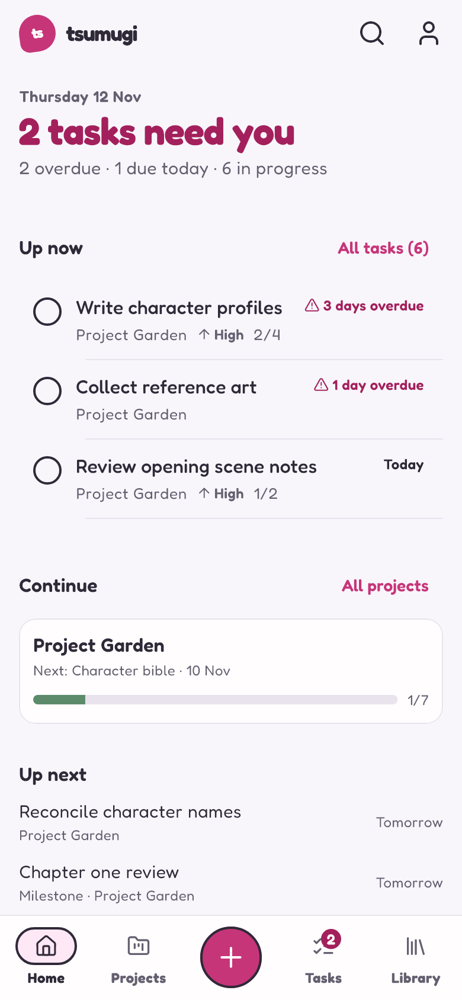 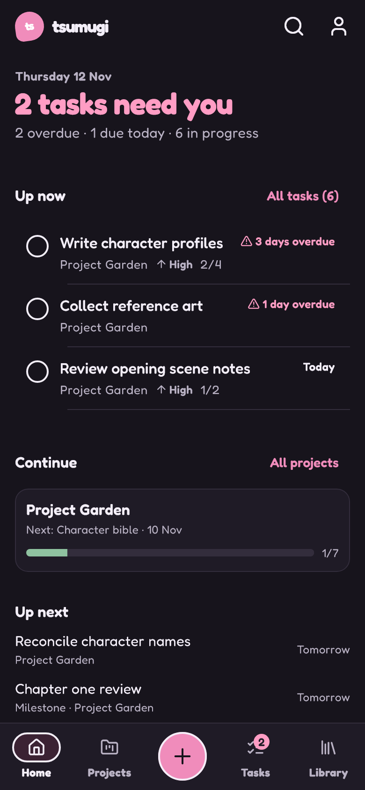

```
[logo]                              [search] [account]
Thursday 12 Nov                     (13 muted)
2 tasks need you                    (32 bold, red if overdue)
2 overdue · 1 due today · 6 in progress   (15 muted)

Up now                                   All tasks (6)
( ) Write character profiles                 3 days overdue
    Project Garden · ↑ High · 2/4
( ) Collect reference art                    1 day overdue
( ) Review opening scene notes                       Today

Continue                                    All projects
┌ Project Garden ───────────────────────────┐
│ Next: Character bible · 10 Nov            │
│ ▓▓░░░░░░░░░░░░░░░░░░░░░░░░░░░░░░░░░░░ 1/7 │
└───────────────────────────────────────────┘
Up next
Reconcile character names                  Tomorrow
Chapter one review (milestone)             Tomorrow
[ See insights ]
```

### 10.2 Tasks

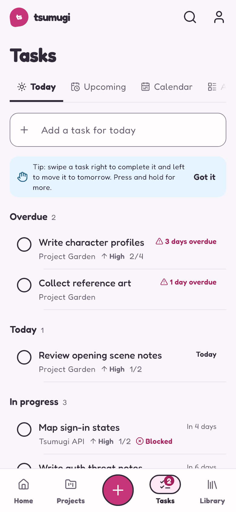 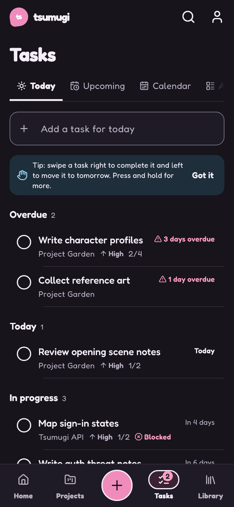 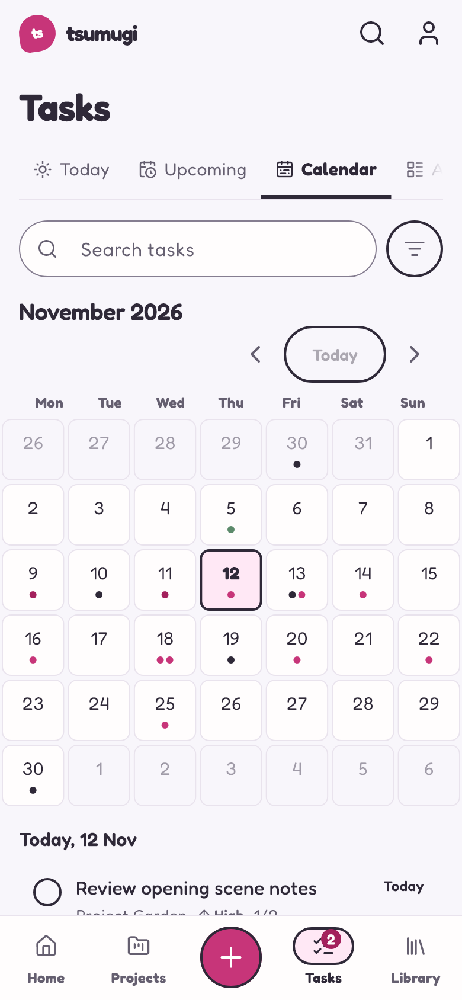

```
[logo]                              [search] [account]
Tasks                               (32 bold)
Today  Upcoming  Calendar  All      (pinned tabs, fade at the edge)
┌ + Add a task for today ────────────────┐   (the only box on Today)
[tip: swipe right = done, left = tomorrow]  Got it   (once)
Overdue 2
( ) row ... ( ) row ...
Today 1
In progress 3     (group headers stay pinned while scrolling)
```

### 10.3 Projects and the project page

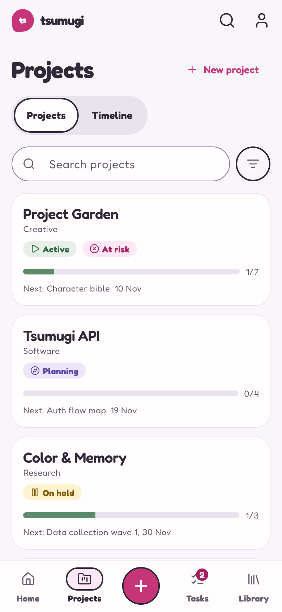 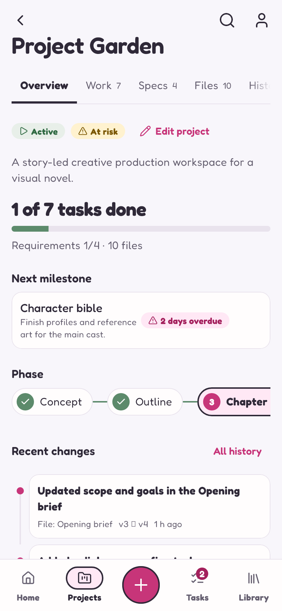 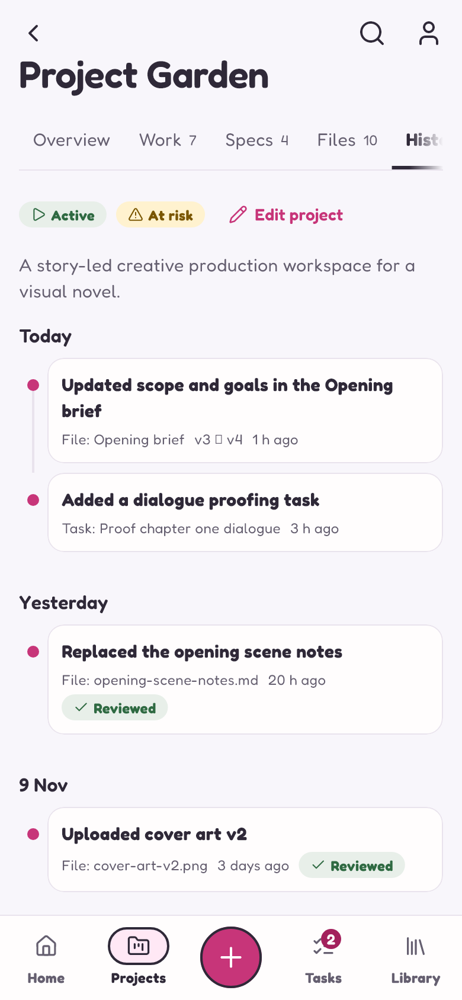 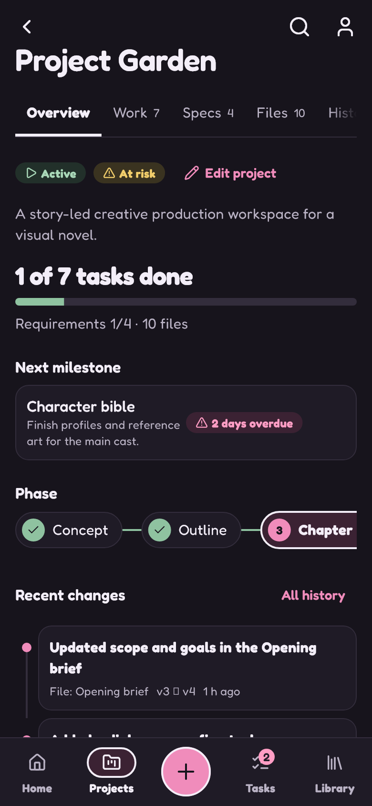

```
Projects                          + New project   (quiet action)
[ Projects | Timeline ]           (small switch)
[search ............] (filter)
┌ Project Garden ──────────────┐
│ Creative                     │
│ (Active) (At risk)           │
│ ▓▓░░░░░░░░░░░░░░ 1/7         │
│ Next: Character bible, 10 Nov│
└──────────────────────────────┘
```

```
< Project Garden                  [search] [account]   (collapsing title)
Overview  Work 7  Specs 4  Files 10  History   (pinned tabs)
(Active) (At risk)  ✎ Edit project (quiet)
description
1 of 7 tasks done            (26 bold)
▓▓░░░░░░░░░░░░░░░░░░░░░░░░░
Requirements 1/4 · 10 files
Next milestone  ┌ Character bible ... 2 days overdue ┐
Phase  (Concept ✓)—(Outline ✓)—(Chapter 3)
Recent changes ...
About (quiet, last)
```

### 10.4 Library, reader, Insights, Account

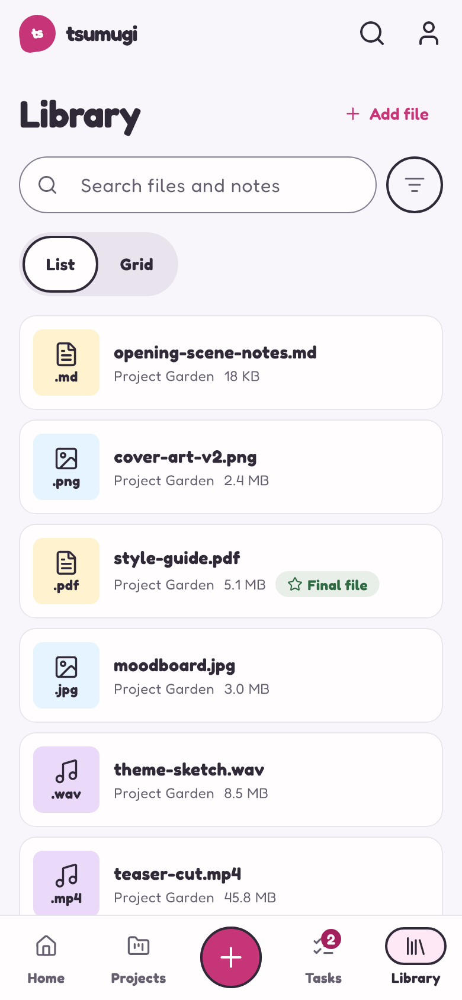 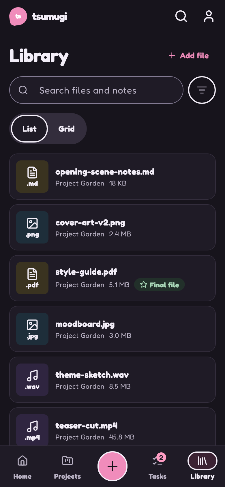 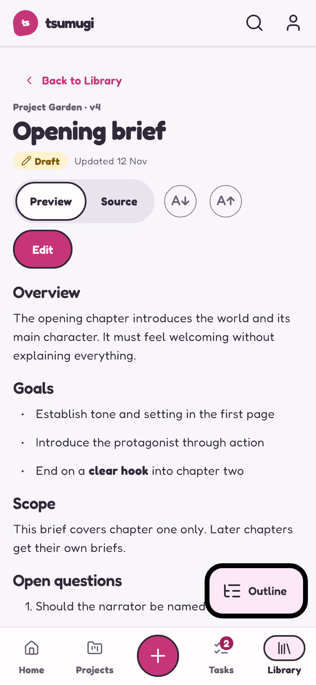 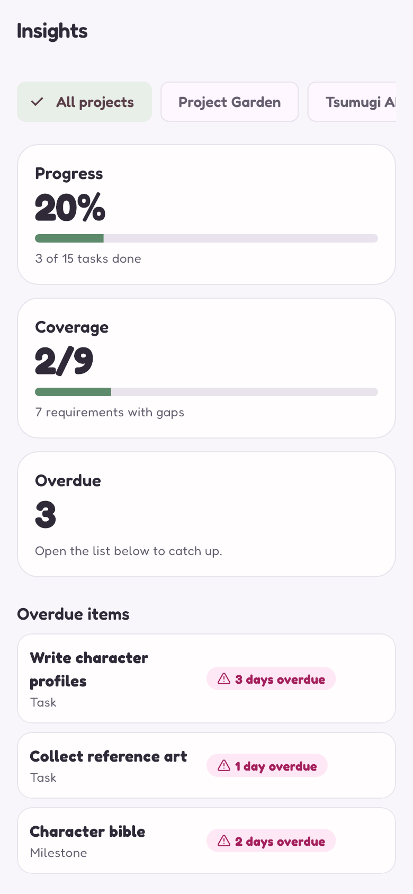 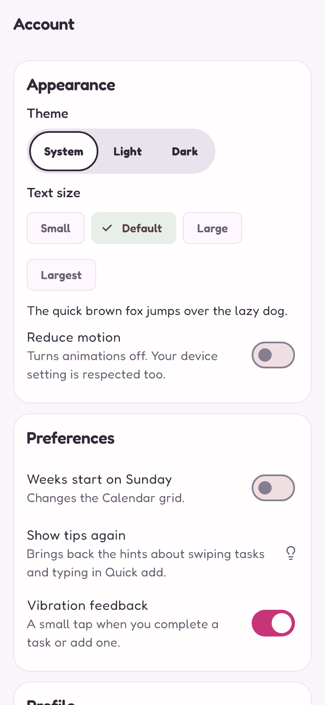

- **Library:** title and a quiet "Add file"; search and filter; List / Grid switch (list is the default); compact rows: file icon block, name, "project · size".
- **Reader:** reading-progress bar at the top, A- and A+ buttons, a floating **Outline** button that opens a section sheet, a Source view with line numbers.
- **Insights:** a row of project chips (scrolls sideways), three cards (Progress %, Coverage x/y, Overdue n), then a list of overdue items. The page title appears once (in the bar).
- **Account:** Appearance first (theme, text size, reduce motion), Preferences (week start, show tips again, vibration), then Profile, Privacy, Developer. Settings apply immediately.

### 10.5 Sign-in, welcome, large text, tablet

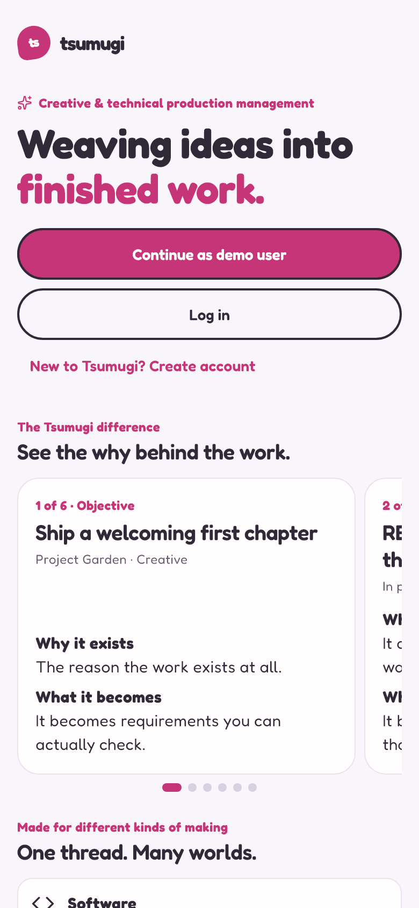 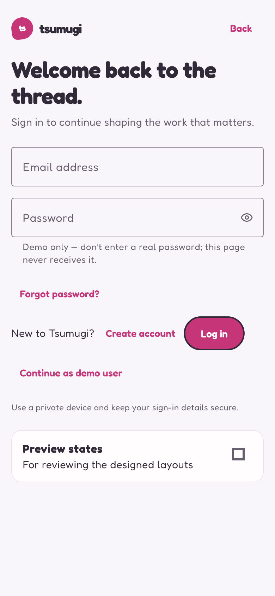 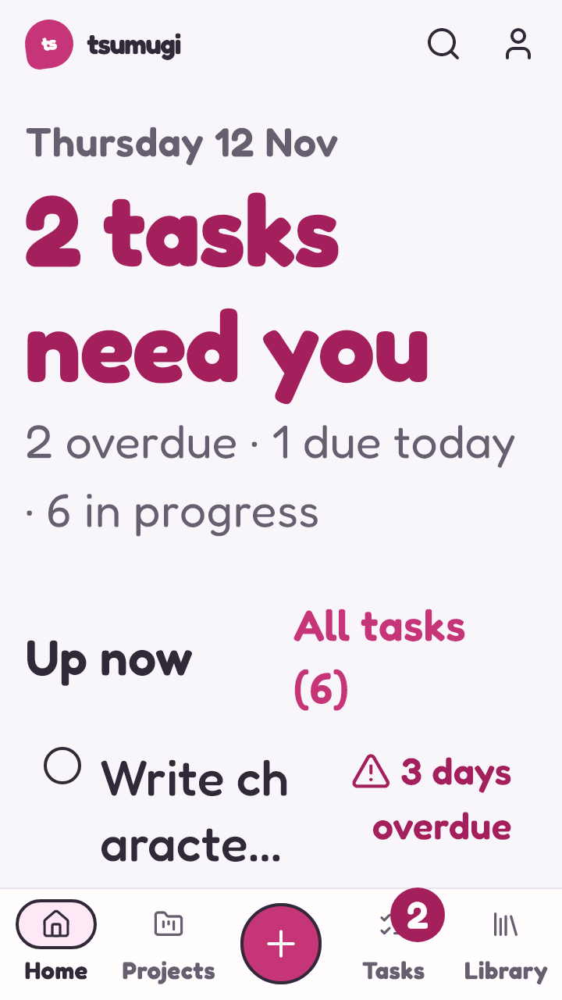 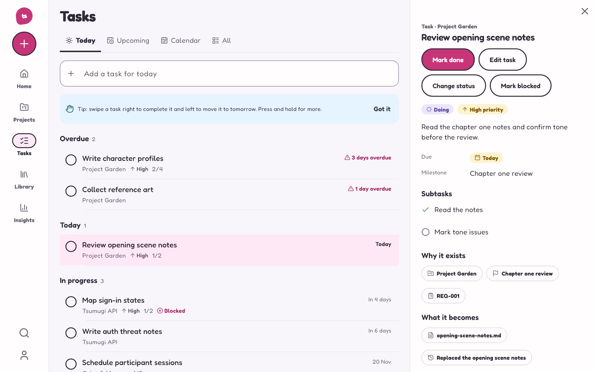

Tablet (1280 x 800): a side rail (Home, Projects, Tasks, Library, Quick add, search, account) and the selected task docked on the right instead of a sheet.

## 11. Website alignment checklist (ordered)

Each item names the website file likely to change. Do A items first; they are safe and separate.

| # | Item | Degree | Effort | Website files | Why |
|---|---|---|---|---|---|
| 1 | Add the new tokens (4.2): `--control-border`, `--on-accent`, `--butter-soft`, tone variables, roles, motion variables | A | S | `base.css`, `workspace.css` | One source for colours; unblocks everything else |
| 2 | Use the tone variables in `.badge--*` and `.due--*` instead of hard-coded hex | A | S | `workspace.css` | Removes about a dozen duplicated hex values; needed for dark |
| 3 | Inputs, search fields, outlined buttons, unselected chips use `--control-border` (3:1) | B | S | `workspace.css`, `forms.css` | WCAG 1.4.11; `--line-strong` is about 1.5:1 |
| 4 | Reduced-motion block (9) for workspace and landing | B | S | `base.css`, `motion.css` | The landing page already respects it; the workspace needs it once it has motion |
| 5 | Text-size floor and scale (section 5): 12 minimum, one meta size 13, row title weight 500 | B | S | `workspace.css` | Calmer lists |
| 6 | Only overdue coloured in lists; today bold; soon muted; priority as text and icon | C | S | `workspace.css` (`.due--*`, priority) | Hierarchy rule 3 |
| 7 | Two-line task row (7.1), milestone and ring out of the row | C | M | `workspace-pages.css`, task components | Hierarchy rule 4 |
| 8 | Home headline block (7.3) and fewer sections | C | M | Home page and CSS | Focal point |
| 9 | Project page: progress statement first, About last, quiet Edit | C | S | project page | Reference information last |
| 10 | Library defaults to a list; quiet Add file | C | S | library page | Density |
| 11 | Remove duplicated page titles (a title once) | C | S | page headers | Rule 10 |
| 12 | Quiet button style (7.6); one primary per screen | C | S | `workspace.css` | Fewer loud things |
| 13 | In-place task actions with Undo toast (10 s, 20 steps) | D | M to L | task components, store | Act first, undo, no confirmation |
| 14 | Grouped lists with counts and sticky group headers | D | M | Tasks page | Scanning |
| 15 | Quick add with project, date and priority chips | D | M | quick add | Fewer steps |
| 16 | Settings that apply at once (theme, text size, week start) | D | M | account page | Honest, immediate |
| 17 | One-time tip, replayable | D | S | Tasks page | Discoverability without a tour |
| 18 | Workspace motion (section 9), reduced-motion aware | E | M | `workspace.css`, small JS | Feedback and orientation |
| 19 | Dark theme switch (system by default, override in settings) | F | M | tokens, account page | Uses the dark tokens |
| 20 | Specific "preview" messages | D | S | wherever previews exist | Honesty about what works |

## 12. Keep different on purpose, and things only the website has

**Keep as is on the web**
- The landing and auth pages' playful motion, parallax, drifting orbs, the cursor ring and the dotted-grid page background.
- The **offset lilac shadow** (`4px 5px 0 var(--lilac)`) and 2 px ink border on menus: this is part of the website's identity; mobile dropped it only because shadows read poorly on small screens. A middle path: keep it on the web menu and dialogs but not on every card.
- Hover states, keyboard shortcuts, focus rings (`outline: 3px solid var(--pink)`; keep, it is good), `scroll-behavior: smooth`, the sticky blurred top bar.
- Wide layouts: rail of 224 px, `max-width: 1280px` content, multi-column dashboards, tables.
- Dense tables and keyboard-first power use that a phone does not need.

**Present on the web, not on mobile (yet):** the full public site and legal pages as a site, real authentication, and (per the plans) things the mobile demo fakes.

**Mobile-only by nature:** swipe gestures, haptics, bottom bar, bottom sheets, predictive back, launcher shortcuts, edge-to-edge system bars.

## 13. Data appendix

- **Targets:** 48 x 48 minimum on phone (computed by Flutter's tap-target guideline on 25 routes in both themes); web: 44 recommended for touch, 24 is the WCAG 2.2 AA floor.
- **Accessibility checks passing in the app** (automated): tap-target size, labelled controls, text contrast, in light and dark, at 100% and 160% text on 25 routes; 320 px wide at 130%; 200% text in dark with no layout errors. Not done: a screen-reader walkthrough and sessions with people.
- **Tests:** 242 pass at the time of writing.
- **Device measurements** (Samsung Galaxy A05s, Android 15, release build, measured): cold start 517 to 677 ms; scrolling median frame 11 ms (90 Hz), none over 25 ms; about 115 MB memory; release APK 55.9 MB (three ABIs).
- **Mobile files to read for exact values:** `lib/core/theme/tokens.dart` (colours, spacing, radii), `lib/core/theme/theme.dart` (type scale, buttons, sheet), `lib/core/theme/motion.dart` (durations and curves), `lib/shared/widgets/task_tile.dart`, `lib/features/home/home_screen.dart`, `lib/shared/widgets/layout.dart`.
- **Reasoning and evidence:** [PLAN-UX.md](PLAN-UX.md) (research with sources, assumptions, the first-impression finding in 5.5, the motion plan in 9.1), [PLAN-MOBILE-UI.md](PLAN-MOBILE-UI.md) (the original mobile design plan).

## 14. Open questions for the website owner

1. Which degree (section 2)? A and B are recommended first, on their own.
2. Keep the offset lilac shadow on every card, or only on menus and dialogs?
3. Is dark mode wanted on the website? If yes, tokens in 4.2 are ready; the landing page art (orbs, thread) would need dark variants.
4. Progress bar fill: ink (web today) or green (mobile)? Green reads as progress; ink matches the site's outline style.
5. Should the website adopt the mobile **headline** on Home, or keep the dashboard of figures? Test both with a few people before changing (see PLAN-UX.md 7).
